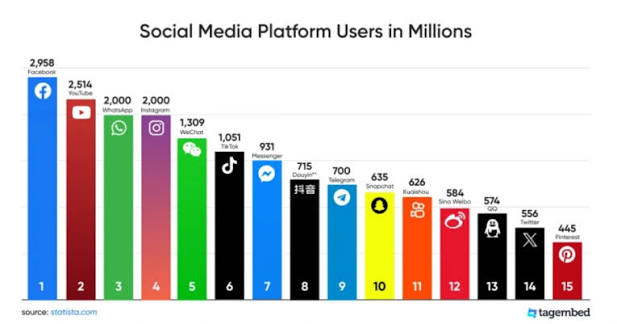
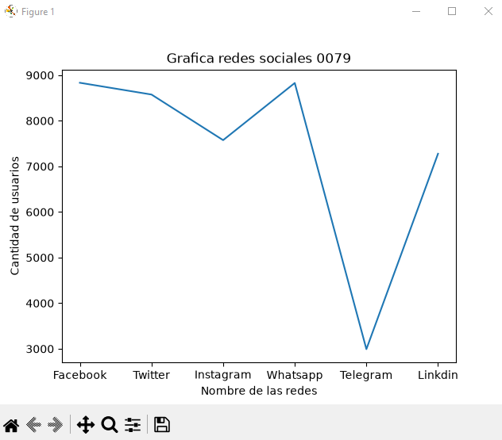
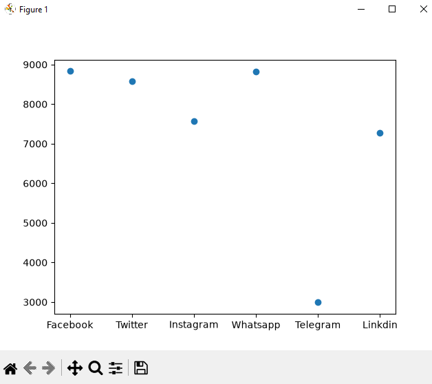
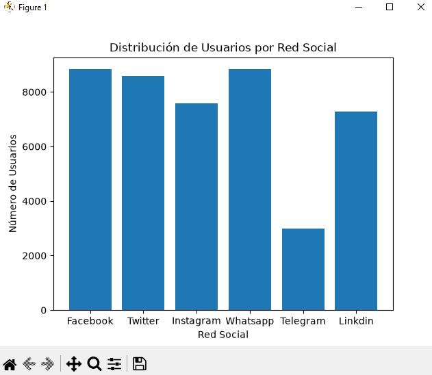
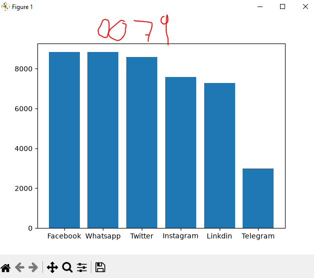
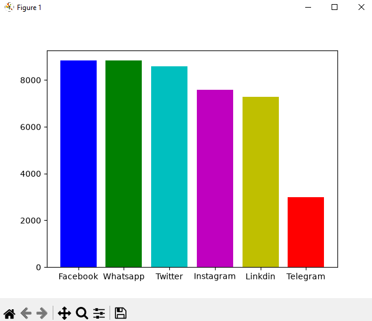
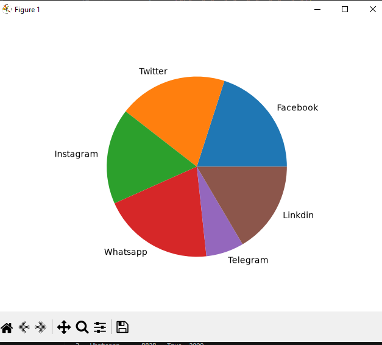

## DataFrame (Marco de datos)

## Reedes sociales a nivel mundial

## Grafica lineal de las redes sociales

## Grafica puntual de las redes sociales

## Grafica de barras de las redes sociales

## Grafica de barras del mas grande al mas chico de forma descendente

## Coloreando la grafica

## Grafica de patel o pie
